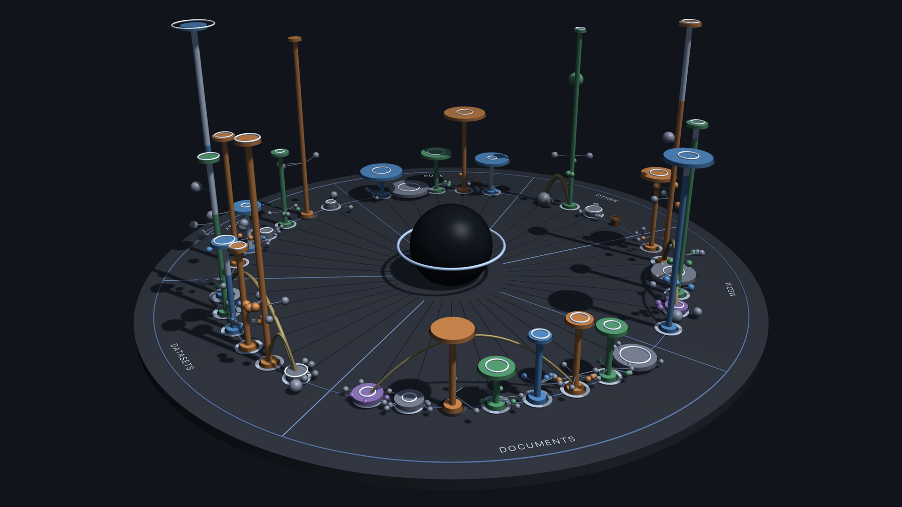

#  ObjectExplorer

**The VS Code for cloud storage.** S3, GCS, Azure Blob, MinIO, OneLake, Google Drive, Dropbox,
OneDrive, Box, FTP and SFTP servers and local disks in one window — every object opened, queried
and modelled in place, on your machine.

[](https://objectexplorer.com)

[objectexplorer.com](https://objectexplorer.com) · [Open it in a browser](https://objectexplorer.com/app) ·
[Documentation](https://objectexplorer.com/what-is-objectexplorer) · [Pricing](https://objectexplorer.com/pricing)

## Install

| Platform                   | Download                                                |
|:---------------------------|:--------------------------------------------------------|
| macOS, Apple silicon       | [objectexplorer-app-darwin-arm64.dmg][mac-arm64.dmg]    |
| macOS, Intel               | [objectexplorer-app-darwin-x64.dmg][mac-x64.dmg]        |
| Windows, x64 installer     | [objectexplorer-windows-x64.msix][windows-x64.msix]     |
| Windows, ARM64 installer   | [objectexplorer-windows-arm64.msix][windows-arm64.msix] |
| Windows, x64 portable      | [objectexplorer-windows-x64.zip][windows-x64.zip]       |
| Windows, ARM64 portable    | [objectexplorer-windows-arm64.zip][windows-arm64.zip]   |
| Linux, x64                 | [objectexplorer-linux-x64.tar.gz][linux-x64.tar.gz]     |
| Linux, ARM64               | [objectexplorer-linux-arm64.tar.gz][linux-arm64.tar.gz] |

[mac-arm64.dmg]: https://objectexplorer.com/download/app-darwin-arm64.dmg?channel=github
[mac-x64.dmg]: https://objectexplorer.com/download/app-darwin-x64.dmg?channel=github
[windows-x64.msix]: https://objectexplorer.com/download/windows-x64.msix?channel=github
[windows-arm64.msix]: https://objectexplorer.com/download/windows-arm64.msix?channel=github
[windows-x64.zip]: https://objectexplorer.com/download/windows-x64.zip?channel=github
[windows-arm64.zip]: https://objectexplorer.com/download/windows-arm64.zip?channel=github
[linux-x64.tar.gz]: https://objectexplorer.com/download/linux-x64.tar.gz?channel=github
[linux-arm64.tar.gz]: https://objectexplorer.com/download/linux-arm64.tar.gz?channel=github

Every link fetches the file from the newest release. Older versions, and the release notes for
each one, are on the [releases page](https://github.com/knockdata/objectexplorer/releases).
Per-platform notes — notarization, SmartScreen, where the Linux binary goes — are in
[getting started](https://objectexplorer.com/getting-started).

With Homebrew, on macOS and Linux:

```sh
brew install knockdata/tap/objectexplorer             # the command line
brew install --cask knockdata/tap/objectexplorer-app  # the desktop app
```

Or run it with no install at all, if you have Node 20+:

```sh
npx @knockdata/objectexplorer
```

The Free plan is a real tool, not a trial: three cloud roots on every provider and five local
folders. Pro lifts every cap — see [pricing](https://objectexplorer.com/pricing).

## What it does

- **One tree for every storage.** S3 and S3 compatible providers, Google Cloud Storage, BigQuery,
  Azure Blob, OneLake, Google Drive, Dropbox, OneDrive, Box, FTP, FTPS and SFTP servers, and the
  folders on your disk, with the same keyboard, as a list or a grid of previews.
  → [connecting storage](https://objectexplorer.com/storage/connect)
- **Every file opened as itself.** More than 900 kinds of file: tables, office files, PDFs and ebooks, pictures and
  camera raw, audio and video, CAD parts, building and 3D models, point clouds, circuit boards,
  scans and medical recordings, mailboxes and chats, maps, molecules, disk images and archives. A
  file is told by its content, not its name. → [every format](https://objectexplorer.com/formats/)
- **SQL over the object, where it lives.** The app's own engine queries a Parquet, CSV, sheet,
  database file or lake table in place; nothing is imported first.
  → [SQL](https://objectexplorer.com/analyze/sql)
- **A notebook per object.** A table opens with a query and a chart already written; Table, Chart,
  Model, Python, JavaScript and Text cells. → [the notebook](https://objectexplorer.com/analyze/notebook)
- **Lake formats read as tables.** Delta, Iceberg and Hudi parsed to their own specifications, with
  deletes, schema evolution and time travel. → [data lake tables](https://objectexplorer.com/analyze/lake)
- **Read, measure and edit.** A PDF reader with notes, ebooks and PDFs read as a book, distances and
  areas measured on drawings, models, boards and pages, and text files edited and saved.
  → [the PDF reader](https://objectexplorer.com/formats/pdf)
- **The bill, and how to cut it.** Every bucket priced on one disc, and Optimize for the cheaper
  class, the single region, the old versions and the abandoned uploads — each a command you run.
  → [where the storage went](https://objectexplorer.com/explore/usage)
- **Search across buckets.** Local folders and cloud prefixes in the same run.
  → [search](https://objectexplorer.com/explore/search)
- **Download in another shape.** A table as Excel or CSV, a deck as PDF, PNG or Word, a folder as a
  zip, or an anonymized copy to test with. → [download and convert](https://objectexplorer.com/explore/download)
- **Ask the agent you use.** Claude, GitHub Copilot, Gemini, ChatGPT or a model of your own in the
  side bar, beside the file you have open. → [agents](https://objectexplorer.com/agents/)
- **An access gateway for agents.** MCP (Model Context Protocol) for Claude Code, Codex or any client:
  the agent holds no credential, personal data is rewritten on the way out, and every call is logged.
  → [agents](https://objectexplorer.com/agents/)

The whole story, one afternoon at a time: [objectexplorer.com/story](https://objectexplorer.com/story/).

## Your data never leaves your machine

Every file is read on your own machine, and objects come from your provider to your computer and
nowhere else: we run no backend that sees your objects, because there is none.
→ [the whole argument](https://objectexplorer.com/privacy)

Under the hood it is one native program for macOS, Windows and Linux: no Electron, no Chromium.
Opened from your applications it is a window; typed in a terminal, it serves the same app to your
browser from `127.0.0.1`.

## Links

- [objectexplorer.com](https://objectexplorer.com) — the product page, the documentation and the stories
- [objectexplorer.com/app](https://objectexplorer.com/app) — the app itself, in a browser
- [@knockdata/objectexplorer](https://www.npmjs.com/package/@knockdata/objectexplorer) — the application bundle behind `npx` and every desktop build
- [Changelog](./CHANGELOG.md) — what changed in each version
- [Releases](https://github.com/knockdata/objectexplorer/releases) — every version, every platform

## License

Source code in this repository is MIT licensed — see [LICENSE](./LICENSE).

The application itself is not covered by it. ObjectExplorer ships as the minified bundle published on
npm as [@knockdata/objectexplorer](https://www.npmjs.com/package/@knockdata/objectexplorer), which
this repository packages into the desktop builds. That bundle is proprietary software of Knock Data
AB, under the terms in the package's `LICENSE.md`. Versions up to and including 0.7.0 were published
under MIT.

The app bundles work by other people, each under its own terms. Every one of them is named, with
its licence text, on the [third-party licenses](https://objectexplorer.com/third-party-licenses) page.
